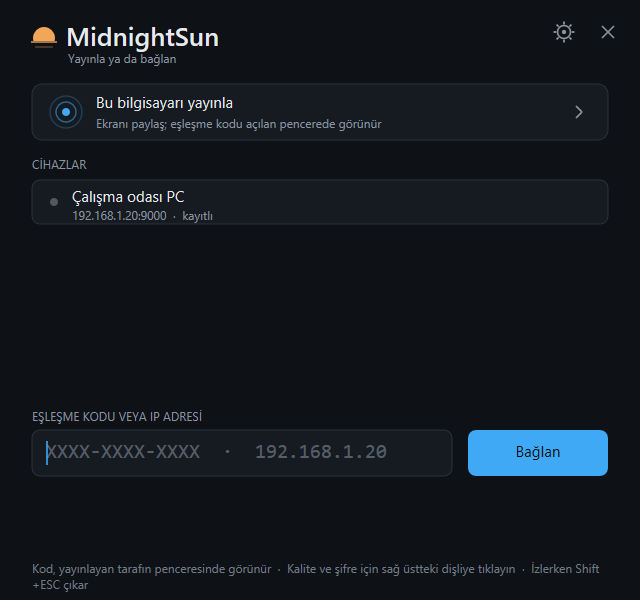

# MidnightSun

**Kendi bilgisayarların arasında, düşük gecikmeli oyun yayını.**

MidnightSun, güçlü Windows PC'nizdeki oyunu (veya masaüstünü) aynı ağdaki
başka bir bilgisayardan **düşük gecikmeyle** oynamanızı sağlar. Ekran
görüntüsü GPU'dan hiç inmeden NVENC ile sıkıştırılır, özel UDP protokolüyle
(GSMR) aktarılır; klavye, fare ve oyun kolu girişleri geri taşınır. Ses de
dahildir (Opus, 20 ms). Hesap, bulut sunucusu ve telemetri yoktur.

| | |
|---|---|
| **İndir: kurulum paketi** | [MidnightSun-Kurulum.exe](https://github.com/ozcinax-star/MidnightSun/releases/latest/download/MidnightSun-Kurulum.exe) |
| **İndir: taşınabilir zip** | [MidnightSun-Portable.zip](https://github.com/ozcinax-star/MidnightSun/releases/latest/download/MidnightSun-Portable.zip) |
| **Tanıtım sitesi** | <https://ozcinax-star.github.io/MidnightSun/> |
| **Tüm sürümler ve SHA-256** | [Releases](https://github.com/ozcinax-star/MidnightSun/releases) |



*Gerçek açılış ekranı (Windows 11, %100 ölçek). Listedeki kayıtlı cihaz
örnek veridir.*

## Öne çıkanlar

- **Tek uygulama, iki rol.** Aynı `MidnightSun.exe` hem yayıncı hem izleyici;
  rol her oturumda açılış ekranından seçilir.
- **IP yazmak yok.** Yayıncı "Bu bilgisayarı yayınla"ya tıklar; izleyici
  aynı ağdaki yayını listede görüp tıklar. Farklı ağ segmentleri için tek
  satırlık eşleşme kodu (`XXXX-XXXX-XXXX`) yeterli.
- **Bağlantı onayı.** Varsayılan olarak yayıncı, "İzin ver / Reddet"
  istemiyle kimin izleyeceğine karar verir.
- **Uygulama içi ayarlar.** Bit hızı, çözünürlük, FPS, port, şifre (PSK) ve
  onay; hepsi sağ üstteki dişliden. Yapılandırma dosyası açmak gerekmez.
- **Uçtan uca şifreleme (isteğe bağlı).** İki tarafta aynı PSK girildiğinde
  tüm trafik AES-256-GCM ile şifrelenir ve doğrulanır.
- **Zero-copy boru hattı.** DXGI Desktop Duplication → NVENC (VRAM içinde)
  → UDP. Uyarlanabilir bit hızı, kayıpta anahtar kare, intra-refresh ile
  kendini onaran görüntü.
- **Tam giriş desteği.** 256 tuşlu klavye bit maskesi, 5 tuşlu fare
  (mutlak/masaüstü ve göreli/oyun modu, F2 ile geçiş), XInput oyun kolu
  (yayıncıda ViGEmBus ile sanal Xbox 360 kolu).
- **Sistem tepsisi.** Yayın penceresi tepsiye küçülür; kod kopyalama ve
  durdurma tepsi menüsünde.

## Sistem gereksinimleri

| | Yayıncı (host) | İzleyici (client) |
|---|---|---|
| İşletim sistemi | Windows 10/11 x64 | Windows 10/11 x64 |
| GPU | NVENC'li NVIDIA (GTX 10xx+; sürücü ≥ 522.25) | H.264 çözebilen herhangi bir GPU |
| Ağ | Gigabit LAN / Wi-Fi 5+ önerilir | aynı |
| İsteğe bağlı | [ViGEmBus](https://github.com/nefarius/ViGEmBus/releases) (oyun kolu için) | — |

## Kurulum

**Kurulum paketiyle (önerilen):** `MidnightSun-Kurulum.exe`'yi çalıştırın.
Başlat menüsü kısayolu oluşturulur, Windows Güvenlik Duvarı'na uygulama
bazlı gelen-UDP izni (özel/etki alanı ağları) otomatik eklenir ve
kaldırırken silinir.

**Taşınabilir:** `MidnightSun-Portable.zip`'i yazılabilir bir klasöre
(Belgeler, Masaüstü…) çıkarın ve `MidnightSun.exe`'yi çalıştırın. İlk
çalıştırmada Windows Güvenlik Duvarı sorarsa "Özel ağlar" için izin verin
(UDP 47800 keşif + yayın portu, varsayılan 9000). Visual C++ çalışma zamanı
DLL'leri pakette, ayrıca kurmanız gerekmez.

**SmartScreen:** Uygulama kod imzalı değildir. Windows "bilgisayarınızı
korudu" derse **Ek bilgi → Yine de çalıştır**. İndirdiğiniz dosyanın
SHA-256 özetini sürüm notlarındakiyle karşılaştırabilirsiniz:

```powershell
Get-FileHash .\MidnightSun-Kurulum.exe -Algorithm SHA256
```

## Kullanım

1. **Yayıncı PC'de** MidnightSun'ı açın → "Bu bilgisayarı yayınla".
   Açılan pencerede eşleşme kodu görünür (tıklayınca kopyalanır).
2. **İzleyici PC'de** MidnightSun'ı açın. Aynı ağdaysanız yayın listede
   kendiliğinden belirir; tıklayın. Değilseniz kodu girin → Bağlan.
3. Yayıncı taraf "X bu yayını izlemek istiyor" istemini onaylar. Bu kadar.

İzlerken: **F1** istatistik katmanı, **F2** fare modu (masaüstü/oyun),
**Shift+ESC** oturumdan çıkış. Bağlanılan cihazlar açılış ekranında
isimleriyle kayıtlı kalır; satırın üzerine gelip **×** ile unutturabilirsiniz.

## Ayarlar (dişli simgesi)

| Ayar | Anlamı | Varsayılan |
|---|---|---|
| En yüksek bit hızı | Uyarlanabilir denetleyicinin tavanı | 20000 kbps |
| Kodlama çözünürlüğü | NVENC öncesi GPU ölçekleme (Yerel = kapalı) | 1080p |
| FPS hedefi | Yakalama/kodlama temposu | 60 |
| Bağlantı portu | GSMR yayın portu | 9000 |
| Şifre (PSK) | İki uçta aynıysa AES-256-GCM açılır | boş (kapalı) |
| Bağlantı onayı | Yeni izleyici için izin istemi | Açık |

## Durum

Sürüm **1.0.0**. Bu sürüm hazırlanırken doğrulananlar: kaynak koddan
sıfırdan derleme (`build_all.bat`, Visual Studio 2022 Build Tools,
Windows 11), taşınabilir paketteki `MidnightSun.exe`'nin açılması, açılış ve
ayarlar ekranlarının çalışması. İki bilgisayar arasında uçtan uca yayın bu
yayın sürecinde ayrıca test edilmedi; kurulum paketi derlendi ancak bu
makinede kurularak denenmedi (güvenlik duvarı kuralı eklediği için).
Gecikme ölçümü yayımlanmamıştır; sonuç ağınıza ve donanımınıza bağlıdır.

## Bilinen sınırlar

- Yalnızca IPv4; NAT geçişi yok (LAN, VPN veya port yönlendirme gerekir).
- Yayıncı tarafta NVIDIA GPU şart (NVENC).
- Döndürülmüş monitörler ve yayıncıda birincil monitör dışındaki ekranlar
  henüz desteklenmez.
- Yalnızca ilk XInput oyun kolu (pad 0) aktarılır.
- PSK statiktir: tekrar koruması/ileri gizlilik yok. LAN için uygundur,
  internet üzerinden kullanımda VPN önerilir.
- Uygulama ve kurulum paketi imzasızdır (SmartScreen uyarısı normaldir).

## Derleme (geliştiriciler)

MSVC 2022 ("Desktop development with C++"), Windows SDK 10, CMake gerekir
(Visual Studio'nun kendi CMake'i de bulunur).

```bat
build_all.bat
powershell -ExecutionPolicy Bypass -File tools\package.ps1
ISCC.exe installer.iss
```

1. `build_all.bat`: önce `extern/` altındaki Opus ve ViGEmClient
   kütüphanelerini derler (bir kez), sonra `build\Release\MidnightSun.exe`.
2. `tools\package.ps1`: `dist\MidnightSun\` klasörünü ve
   `dist\MidnightSun-Portable.zip`'i hazırlar.
3. `ISCC.exe installer.iss` (Inno Setup 6): `Output\MidnightSun-Kurulum.exe`.
   GitHub'da `Installer` iş akışı bu adımı sürümdeki zip'ten otomatik yapar.

Mimari, GSMR protokolü ve iş parçacığı modeli: [docs/ARCHITECTURE.md](docs/ARCHITECTURE.md).

## Lisans

MidnightSun'ın kendi kaynak kodu [MIT lisansı](LICENSE) ile dağıtılır.
`extern/` altındaki üçüncü taraf bileşenler (Opus: BSD-3, ViGEmClient: MIT,
NVIDIA NVENC başlığı: MIT tarzı) kendi lisanslarına tabidir ve MIT
iznine dahil değildir; ayrıntılar [THIRD_PARTY_NOTICES.txt](THIRD_PARTY_NOTICES.txt).

---

## English

MidnightSun streams a game (or the desktop) from a Windows PC with an NVIDIA
GPU to another Windows PC on the same network: DXGI capture, zero-copy NVENC
H.264, a custom UDP protocol (GSMR), Opus audio and an input back-channel
(keyboard, mouse, XInput gamepad via ViGEmBus). One executable plays both
roles; LAN discovery and a pairing code replace typing IP addresses; the host
approves each viewer; an optional pre-shared key turns on AES-256-GCM.
No accounts, no cloud, no telemetry.

Download the [installer](https://github.com/ozcinax-star/MidnightSun/releases/latest/download/MidnightSun-Kurulum.exe)
or the [portable zip](https://github.com/ozcinax-star/MidnightSun/releases/latest/download/MidnightSun-Portable.zip).
The binaries are unsigned, so SmartScreen may warn. No latency figures are
published. Build from source with `build_all.bat` (VS 2022); architecture
notes are in [docs/ARCHITECTURE.md](docs/ARCHITECTURE.md). MIT licence for
MidnightSun's own code; third-party components keep their own licences.
